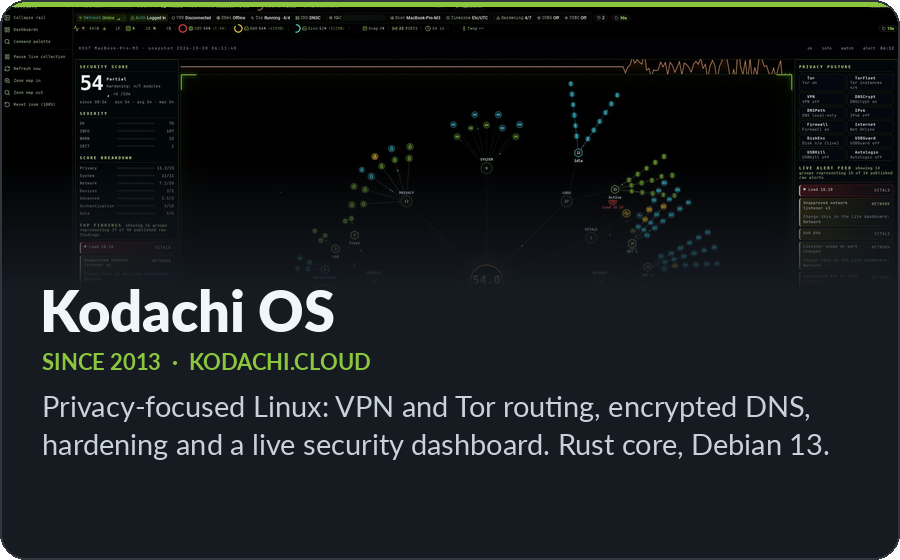
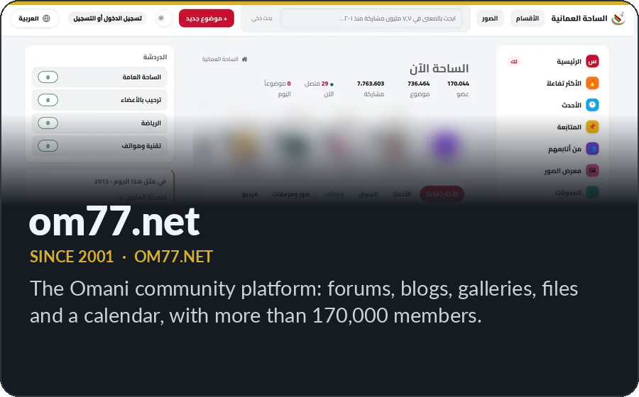
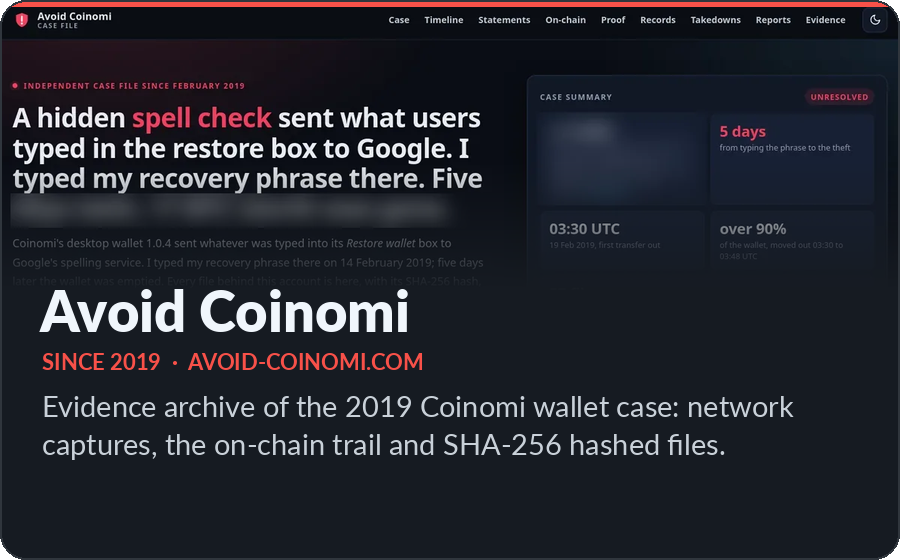
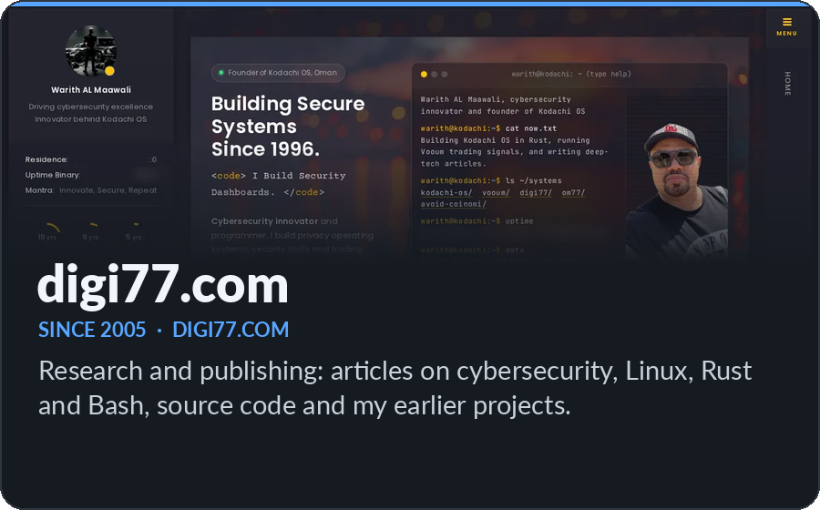
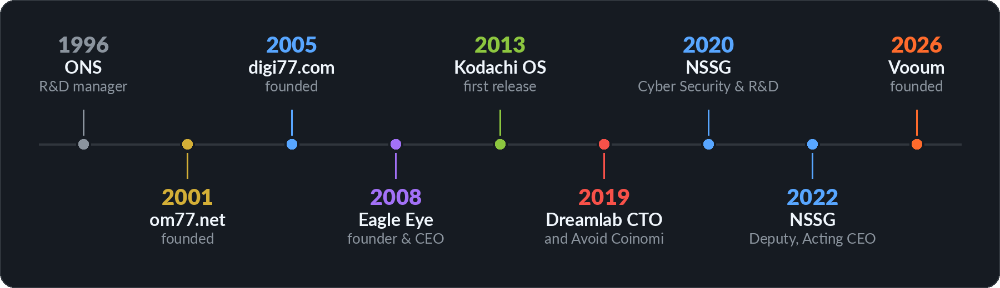

 

> I build technologies that make privacy, security, and complex technical research more accessible. My career spans **30 years** across cybersecurity, digital forensics, research and development, and technology leadership, and I still combine executive work with hands-on engineering: I write the core **Rust** stack of Kodachi OS and sign every release myself.

 

## The systems I founded

Click a card to open the system · <a href="https://www.digi77.com/founder/">One founder, five systems</a> · Kodachi source: <a href="https://github.com/WMAL/kodachios">WMAL/kodachios</a>

 

## Recognition

| | Year | Recognition | By |
|:---:|:---:|---|---|
| 🥇 | 2020 to 2025 | **Kodachi ranked first six years running**, best Linux distro for privacy and security | [TechRadar](https://www.techradar.com/news/best-linux-distro-privacy-security) |
| 🥇 | 2025 | **Kodachi listed first**, 5 best Linux distros for staying anonymous | [ZDNet](https://www.zdnet.com/article/5-best-linux-distros-for-staying-anonymous-when-a-vpn-isnt-enough/) |
| 🥇 | 2025 | **Kodachi listed first**, Linux distributions for keeping your digital identity secret | [Al Jazeera Net](https://www.aljazeera.net/tech/2025/6/17/%d8%a3%d9%81%d8%b6%d9%84-%d8%aa%d9%88%d8%b2%d9%8a%d8%b9%d8%a7%d8%aa-%d9%84%d9%8a%d9%86%d9%83%d8%b3-%d9%84%d9%84%d8%ad%d9%81%d8%a7%d8%b8-%d8%b9%d9%84%d9%89-%d8%b3%d8%b1%d9%8a%d8%a9) |
| 🏅 | 2024 | **PassRay** (NSSG), highly commended: Outstanding Cybersecurity Product of the Year | [Intersec 2024](https://timesofoman.com/article/141326-nssgs-passray-honoured-as-outstanding-cybersecurity-product-of-the-year-at-intersec-2024) |
| 🏆 | 2023 | **Named one of the Top 50 CEOs of 2023**, as Acting CEO of NSSG | [Arabian Business](https://www.arabianbusiness.com/listing/revealed-arabian-business-top-50-ceos-of-2023) |
| 🏆 | 2023 | **NSSG, Cybersecurity Company of the Year**, accepted as Acting CEO | [OER Corporate Excellence Awards](https://www.einpresswire.com/article/668529907/nssg-awarded-cybersecurity-company-of-the-year-at-oer-corporate-excellence-awards-2023) |
| 🏆 | 2023 | **NSSG, Excellence in Technology** | [COMEX 2023](https://www.samenacouncil.org/samena_daily_news?news=96634) |
| 🥇 | 2022 | **Linux Kodachi ranked #1** of the 9 best Linux distros for privacy-focused users | [MakeUseOf](https://www.makeuseof.com/best-linux-distros-for-privacy-security/) |
| 🏆 | 2021 | **Lab Hot Product**, Linux Kodachi | [APC Magazine](https://kodachi.cloud/downloads/installers/press/APC-Magazine--496-August-2021-Australia.pdf) |
| 🥇 | 2021 | **Linux Kodachi listed first**, Top 10 Most Secure Linux Distros for Personal Use | [LinuxHint](https://kodachi.cloud/downloads/installers/press/Linuxhint.pdf) |
| 🥇 | 2020 | **Top privacy distribution**, Linux Kodachi | [Linux Format](https://kodachi.cloud/downloads/installers/press/Linux_Format_UK_Issue_267_September_2020.pdf) |
| 🥇 | Earlier | **SSL Eye**, first place in the innovation competition | [ITU Arab Regional Cybersecurity Center](https://www.digi77.com/archived-projects/) |

Every review, ranking and award, with saved copies: <a href="https://kodachi.cloud/docs/overview.html#recognition">kodachi.cloud recognition page</a>

 

## Career

<b>Roles in detail</b>

 

| Years | Role | Organization |
|:---:|---|---|
| 2022 to 2024 | Deputy CEO, then Acting Chief Executive Officer | National Security Services Group (NSSG), now part of Dreamlab Technologies |
| 2020 to 2022 | Chief Cyber Security and R&D | National Security Services Group (NSSG), now part of Dreamlab Technologies |
| 2019 | Chief Technology Officer | Dreamlab Technologies |
| 2008 to 2017 | Founder & Chief Executive Officer | Eagle Eye Digital Solutions |
| 1996 to 2015 | Senior Research & Development Manager: a 40-member technical team and a national digital forensics laboratory | ONS |

**Education:** Master's in E-Commerce and Bachelor's in Internet Computing, Griffith University (Brisbane) · Diploma in Computer & Information Systems, Sultan Qaboos University

 

## Stack

 

 

## Open source

**[kodachios](https://github.com/WMAL/kodachios)**  
Kodachi OS, the Debian-based privacy and security operating system.

**Archived tools**, kept as source for learning: [Shy-Girl](https://github.com/WMAL/Shy-Girl) (2013, domain reconnaissance) · [E-Tornado](https://github.com/WMAL/E-Tornado) (remote administration) · [FX-Storm](https://github.com/WMAL/FX-Storm) (2008, Forex analysis) · [Auto-IP-Changer](https://github.com/WMAL/Auto-IP-Changer) (2010) · [MSN-Messenger-Tool](https://github.com/WMAL/MSN-Messenger-Tool) (2008) · [Mail-Robot](https://github.com/WMAL/Mail-Robot) (2007, .eml to .pst)

 

This page loads no trackers or view counters · Muscat, Oman · <a href="https://www.digi77.com/founder/">digi77.com/founder</a>

